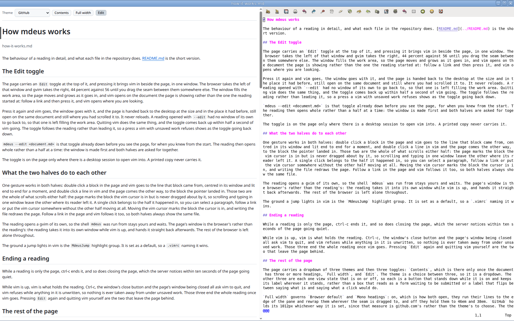

# mdeus

> {Chrome, Chromium, Brave, Vivaldi, Edge} on the left / gvim on the right. Same document on both sides

<p align="center">
  
</p>

`mdeus notes.md` opens the document in a browser window that carries the page and nothing else: no address bar, no tabs, no bookmarks, and it fills the screen. The page redraws the moment the file changes, whoever changed it, and a document opens where you left it, the way vim opens a file at the line you left it on. Open a document that is already open and the window showing it comes to the front, rather than a second one opening.

Press `Edit` at the top of the page and vim opens beside it in the same window. Double click anything in the page, a paragraph, an item of a list, a row of a table, and vim goes to the line it came from. Double click a line in vim, or press `enter` on it, and the page comes the other way. `alt` and an arrow moves the keyboard between the two halves, left for the page and right for vim. Press `Edit` again and vim goes, and the page is handed back to the desktop exactly where it was. Leave vim on `:wq` or `:x` instead and the whole reading ends with it, page and all.

Type `:vs` in the page and it splits in two side by side, or `:sp` and it splits in two one above the other, the way vim splits a window. Each half follows its own links, `alt` and an arrow moves the keyboard between them, and either command typed again closes the second half. `Edit` waits while the page is split, so vim only ever comes in beside a page in one piece. `ma` marks the place the page is at and `'a` comes back to it, as in vim.

## Install

```bash
git clone https://github.com/li9i/mdeus.git ~/mdeus
~/mdeus/install.sh
```

- Installable in Ubuntu, or anything close enough to it.
- The installer links five files into `~/.local` pointing back at the checkout. Nothing is copied anywhere, so `git pull` is the whole of updating it. It also adds one entry to your git settings, so that `git difftool -t mdeus` works. The tool git opens by default is left as it is.
- `~/mdeus/uninstall.sh` takes the five links, that git entry and the settings a reading stored back out again. It leaves the checkout and the packages where they are.
- `~/.local/bin` has to be on your `PATH`. Ubuntu's stock `~/.profile` puts it there at login once the directory exists, so a fresh machine wants one log out and back in.

## Use

```
mdeus notes.md              read it in a window of its own
mdeus --edit notes.md       the same, with vim beside it from the start
mdeus --tab notes.md        read it in a tab of your default browser
mdeus --print notes.md      write one self contained HTML file, print its path
mdeus --diff old.md new.md  show what changed from old.md to new.md on one page
```

Only a document named `.md` or `.markdown` opens. Anything else is refused in one line: `mdeus: not a markdown document: run.py`.

`mdeus --diff old.md new.md` shows what changed from one document to the other as one page: the new words on a green ground, the old ones in dark red on a pale red ground, and everything else as a reading draws it. `git difftool -t mdeus` does the same for a change git knows about. `git difftool -t mdeus HEAD~3 -- notes.md` compares `notes.md` three commits back with how it reads now. git opens the documents one at a time, the next when you close the page, and mdeus turns away any file that is not markdown. The page is read only and redraws when the file is written, so `git difftool -t mdeus` on its own follows your edits as you save them.

Either side of `--diff` can be a pull request on GitHub instead of a file. `mdeus --diff notes.md https://github.com/org/repo/pull/12` compares `notes.md` with the description of pull request 12, and the page goes under the link. A link copied from a tab or a comment of the pull request, such as `.../pull/12/files`, works as well. `gh` fetches the description once, as the page opens, so a private repository is read as whoever `gh` is logged in as, and an edit made on GitHub shows only when you run the command again. `notes.md` still redraws each time you save it. A link to anything but a pull request is refused: `mdeus: not a markdown document: https://github.com/org/repo/issues/12`.

## What it needs

Python 3, one of Chrome, Chromium, Brave, Vivaldi or Edge for the window with nothing in it but the page, and a vim built with `+clientserver` and a GUI for the `Edit` toggle. Without one of them a reading opens in an ordinary tab instead. Comparing with a pull request needs `gh`, logged in to GitHub with `gh auth login`. On Ubuntu the installer fetches all of it:

```
python3-markdown-it  python3-mdit-py-plugins  python3-linkify-it
python3-emoji  python3-lxml  python3-xlib  python3-pil  vim-gtk3  gh
```

Everything else is the standard library. Nothing is fetched at runtime except the description of a pull request named to `--diff`, no page loads an external font, script or stylesheet, and the server listens on `127.0.0.1` and nowhere else.

## More

[How it works](docs/how-it-works.md) covers the `Edit` toggle, the sync between the two halves, the themes and the page, and what each file in the repository does.

[Checks](docs/checks.md) is the test command, and the manual list to walk after touching anything to do with the browser, the windows or vim.

## Licence

[MIT](LICENSE), with one exception. The application icon under `share/icons` was cut from Buuf by Paul Davey, which is Creative Commons Attribution-NonCommercial-ShareAlike, so those two PNG files carry that licence instead and may not be used commercially. Nothing depends on them: delete them, or put your own image there, and everything left is MIT.

The stylesheet embeds seven of GitHub's Octicons, which are MIT too. `share/mdeus/mermaid.min.js` is mermaid's own script, MIT as well, and carries DOMPurify inside it, which is Apache 2.0 or MPL 2.0 at your choice. [NOTICE](NOTICE) carries their notices and the full detail on all three.

## Disclaimer

`mdeus` was created by li9i and coded by Claude. What a time to be alive.
